# 🔍 Awesome Unified Enterprise Search ⚡

> **A curated collection of unified enterprise search engines, AI-powered workplace answer engines, RAG context platforms, and open-source search infrastructure.**  
> Unify siloed data across Google Workspace, Microsoft 365, Slack, Jira, GitHub, Notion, and databases with permission-aware access control and Model Context Protocol (MCP) support.

⭐ **Star this repository if you find it valuable for your engineering and data architecture needs!** ⭐

---

## 📑 Table of Contents

- [🌐 Sector Overview & Market Dynamics](#-sector-overview--market-dynamics)
- [🏢 SaaS & Hosted Enterprise Search Platforms](#-saas--hosted-enterprise-search-platforms)
  - [Feature & Pricing Matrix (Sorted by Scale)](#-feature--pricing-matrix-sorted-by-scale)
  - [Detailed SaaS Profiles](#-detailed-saas-profiles)
- [💻 Open-Source Enterprise Search Software](#-open-source-enterprise-search-software)
  - [Ranked by GitHub Community Stars](#-ranked-by-github-community-stars)
  - [Detailed Open-Source Profiles](#-detailed-open-source-profiles)
- [📊 Comprehensive Architecture Comparison](#-comprehensive-architecture-comparison)
- [🧩 Key Selection Criteria & Evaluation Framework](#-key-selection-criteria--evaluation-framework)
- [⭐ Star History](#-star-history)
- [💖 Support](#-support)
- [🤝 Contributing](#-contributing)
- [📜 License](#-license)

---

## 🌐 Sector Overview & Market Dynamics

The global enterprise search market is valued at approximately **$5.8B – $6.7B** and is projected to expand toward **$8.9B – $12.8B by 2030** at an estimated CAGR of **8.0% – 9.3%**, driven by the modernization of corporate intranets, massive growth in unstructured business communications, and enterprise-wide adoption of Retrieval-Augmented Generation (RAG).

The sector exhibits a **moderately fragmented, bifurcated market structure**: hyperscalers and legacy software conglomerates (Microsoft 365 Copilot, Google Cloud Vertex AI Search, and AWS) dominate foundational ecosystem-native search in a semi-concentrated tier, while independent best-of-breed vendors (such as Glean, Coveo, Elastic, and emerging open-source stacks) capture substantial market share by excelling at cross-silo data connectors, hybrid BM25 + dense neural retrieval, and early-binding permission graph synchronization across hybrid cloud environments.

---

## 🏢 SaaS & Hosted Enterprise Search Platforms

### 📋 Feature & Pricing Matrix (Sorted by Scale)

The table below lists leading commercial SaaS and managed cloud solutions for enterprise search, sorted in descending order by enterprise scale (company valuation / market cap / revenue run-rate):

| Platform | Category / Primary Focus | Company Scale (Valuation / Revenue) 🔽 | Base Starting Pricing | Free Tier / Trial Limit | Permission Enforcement |
| :--- | :--- | :--- | :--- | :--- | :--- |
| **[Perplexity Enterprise](https://www.perplexity.ai/enterprise)** | AI Answer Engine & Corporate Autonomous Agents | **$20B+ Valuation** ($450M+ ARR) | **$40 / seat / month** ($400/seat/yr on Enterprise Pro) | **No Free Trial**; individual consumer tier limited to 3 Pro searches/day and 1 Research query/month | Centralized File Connectors, SSO, workspace workspace governance |
| **[Elastic Cloud](https://www.elastic.co/cloud)** | Distributed Search, Observability & Vector Database | **$8.5B Market Cap** ($1.74B ARR) | **$99 / month** (Standard hosted cluster: 120 GB storage across 2 AZs) | **14-Day Free Trial** with full access up to 2 instances across AWS, GCP, or Azure | Document-level & field-level security (RBAC/ABAC) |
| **[Glean](https://www.glean.com)** | Enterprise AI Coworker & Unified Work Search | **$7.2B Valuation** ($300M+ ARR) | **$35 – $75+ / user / month** (Requires custom contract, ~100-seat minimum, $25K–$60K annual commit) | **No Free Tier or Free Trial**; paid enterprise Proof of Concept (POC) only | Real-time source-level permission parity (Google Drive, Slack, Confluence, etc.) |
| **[Amazon Kendra](https://aws.amazon.com/kendra/)** | Cloud-Native Semantic Search & RAG Service | **Amazon AWS** (~$100B+ ARR Cloud Division) | **$0.32 / hour** (~$230/mo for GenAI Enterprise Edition base index) | **750 hours free for first 30 days** across Developer & GenAI Editions (data connector scan fees excluded) | AWS IAM, OpenID Connect & source access control lists (ACLs) |
| **[Coveo](https://www.coveo.com)** | AI-Relevance, Commerce & Hybrid Workplace Search | **$415M CAD Market Cap** (~$148M USD Revenue) | **$990 / month** (Coveo for Salesforce Pro+ package; core platform starts ~$600–$1,320+/mo) | **14-Day Free Trial** with full platform access and 25+ connectors without credit card | Early-binding document-level security & multi-tenant identity mapping |

---

### 🔍 Detailed SaaS Profiles

#### 1. 🤖 [Perplexity Enterprise](https://www.perplexity.ai/enterprise)
* **Company Status & Footprint:** High-growth AI frontier company with a **$20B+ valuation** and **$450M+ ARR**.
* **Architecture & Focus:** AI answer engine delivering grounded, cited answers and proactive multi-step task execution (via Perplexity Computer). Centrally aggregates internal cloud drives, files, and web sources into a unified query canvas.
* **Pricing & Free Limits:**
  * **Starting Pricing:** **$40 per seat / month** (Enterprise Pro billed monthly) or **$34/seat/month** ($400/year billed annually). Enterprise Max tier available at **$325 per seat / month**.
  * **Free Tier / Trial Limit:** **No self-serve free trial** for enterprise organizations (requires sales qualification). The free consumer plan is restricted to 3 Pro queries/day and 1 Deep Research query/month with no team file indexing.
* **Access Control:** Integrates with Okta, Azure AD, and Google Workspace SSO, enforcing internal governance boundaries without training model weights on proprietary data.

#### 2. ⚡ [Elastic Cloud](https://www.elastic.co/cloud)
* **Company Status & Footprint:** Public enterprise search titan (NYSE: `ESTC`) holding an **~$8.5B market capitalization** and generating **$1.74B in annual revenue**.
* **Architecture & Focus:** Industrial-strength search foundation providing Elasticsearch vector database, BM25 text retrieval, and ELSER (Elastic Learned Sparse EncodeR) semantic models. Elastic is transitioning from its legacy App/Workplace Search packages to pure serverless and hosted Elasticsearch workflows.
* **Pricing & Free Limits:**
  * **Starting Pricing:** **$99 per month** for the baseline hosted Standard tier (bundles ~120 GB storage, RAM allocations across 2 Availability Zones). Serverless ingestion starts at **$0.07/GB ingested** plus **$0.017/GB retained/month**.
  * **Free Tier / Trial Limit:** Fully functional **14-Day Free Trial** allowing provisioning of hosted Elasticsearch clusters across Amazon AWS, Google Cloud, or Microsoft Azure with no credit card required.
* **Access Control:** Granular Role-Based Access Control (RBAC), Attribute-Based Access Control (ABAC), document-level security, and encrypted index aliases.

#### 3. 🎯 [Glean](https://www.glean.com)
* **Company Status & Footprint:** Industry unicorn valued at **$7.2B** with over **$300M in ARR** (scaling from $100M ARR in 15 months).
* **Architecture & Focus:** Enterprise AI assistant built upon a deep enterprise search index. Connects 100+ business applications (Google Workspace, Microsoft 365, Confluence, Jira, GitHub, Slack) to surface grounded answers with line-level citations, knowledge graphs, and cross-team contributor discovery.
* **Pricing & Free Limits:**
  * **Starting Pricing:** Range of **$35 to $75+ per user / month** under Glean Enterprise Flex licensing. Requires an annual contract minimum typically starting around **$25,000 to $60,000+** (~100 minimum seat threshold).
  * **Free Tier / Trial Limit:** **Strictly no free tier and no free trial**. Pilot evaluations require structured, paid Proof-of-Concept (POC) enterprise contracts.
* **Access Control:** Real-time query-time security resolution that mirrors native repository permissions down to document-level Access Control Lists (ACLs).

#### 4. ☁️ [Amazon Kendra](https://aws.amazon.com/kendra/)
* **Company Status & Footprint:** Flagship enterprise search service operated by Amazon Web Services (AWS annual revenue run rate exceeding **$100B+**).
* **Architecture & Focus:** Managed machine-learning search service with natural language understanding (NLU), pre-built document enrichment, and semantic passage ranking. Optimized for building RAG applications on AWS Bedrock.
* **Pricing & Free Limits:**
  * **Starting Pricing:** **$0.32 per hour** (~$230/month) for the GenAI Enterprise Edition base index (covers up to 20,000 documents or 200 MB extracted text). Basic Enterprise Edition starts at **$1.40/hour** (~$1,008/month for up to 100,000 documents).
  * **Free Tier / Trial Limit:** **750 hours of free usage during the first 30 days** across Developer Edition or GenAI Enterprise Edition (note: data source crawler and sync runtime fees are excluded from the free allowance).
* **Access Control:** AWS Identity and Access Management (IAM), SAML 2.0 / OpenID Connect, and fine-grained user context filtering via document ACL tokens.

#### 5. 🏷️ [Coveo](https://www.coveo.com)
* **Company Status & Focus:** Public enterprise relevance company (TSX: `CVO`) with a market capitalization of **~$415M CAD** (~$300M USD) and annual revenue of **$148M USD**.
* **Architecture & Focus:** AI-driven search relevance and generative answering platform tailored for high-scale enterprise knowledge bases, customer service portals (ServiceNow, Salesforce), and digital workplace intranets.
* **Pricing & Free Limits:**
  * **Starting Pricing:** Coveo for Salesforce Pro+ starts at **$990 per month** (billed annually). Dedicated enterprise platform deployments start at **~$600 to $1,320+ per month** bundled with query bucket units (typically 100,000 queries/mo).
  * **Free Tier / Trial Limit:** **14-Day Free Trial** offering self-serve access to indexers, standard machine learning relevance models, and 25+ native connectors without upfront payment.
* **Access Control:** Early-binding document-level security indexing, automated permission updates, ISO 27001, HIPAA, and SOC 2 Type II compliance.

---

## 💻 Open-Source Enterprise Search Software

### ⭐ Ranked by GitHub Community Stars

The open-source landscape offers powerful, self-hostable alternatives ranging from complete permission-aware workplace search suites to high-throughput distributed retrieval engines. 

Below is the community ranking sorted in **descending order by GitHub stargazers count** (each badge links directly to the project's stargazers page):

| Project | GitHub_Stars_Badge (Links to Stargazers) | Primary Tech Stack | License | Core Focus |
| :--- | :--- | :--- | :--- | :--- |
| **[RAGFlow](https://github.com/infiniflow/ragflow)** |  | Python / C++ / Docker | Apache-2.0 | Deep document parsing & RAG engine for complex enterprise templates |
| **[Elasticsearch](https://github.com/elastic/elasticsearch)** |  | Java / Lucene | AGPL-3.0 / ELv2 | Distributed full-text search, analytics & dense/sparse vector retrieval |
| **[Meilisearch](https://github.com/meilisearch/meilisearch)** |  | Rust | MIT | Lightning-fast, typo-tolerant search engine with hybrid vector search |
| **[SearXNG](https://github.com/searxng/searxng)** |  | Python / Flask | AGPL-3.0 | Privacy-respecting, hackable metasearch engine aggregating 70+ sources |
| **[Khoj](https://github.com/khoj-ai/khoj)** |  | Python / FastAPI / React | AGPL-3.0 | Self-hosted AI second brain & desktop search across personal/team notes |
| **[Qdrant](https://github.com/qdrant/qdrant)** |  | Rust | Apache-2.0 | Vector similarity search engine & payload filtering for enterprise RAG |
| **[Onyx](https://github.com/onyx-dot-app/onyx)** *(formerly Danswer)* |  | Python / TypeScript / Vespa | MIT | Complete open-source workplace search & AI chat with native connectors |
| **[Typesense](https://github.com/typesense/typesense)** |  | C++ | GPL-3.0 | Fast, typo-tolerant in-memory search engine and Algolia/Elastic alternative |
| **[OpenSearch](https://github.com/opensearch-project/OpenSearch)** |  | Java / Lucene | Apache-2.0 | Truly open-source distributed search, k-NN vector search & log analytics |
| **[Vespa](https://github.com/vespa-engine/vespa)** |  | C++ / Java | Apache-2.0 | Billion-scale search, vector similarity & real-time online ML inference |
| **[PipesHub](https://github.com/pipeshub-ai/pipeshub-ai)** |  | Python / TypeScript / Docker | Apache-2.0 | Permission-aware AI context layer, MCP connector hub & Glean alternative |
| **[Gerev AI](https://github.com/GerevAI/gerev)** |  | Python / Docker | Apache-2.0 | AI workplace search surfacing conversational answers across Slack & wikis |
| **[Apache Solr](https://github.com/apache/solr)** |  | Java / Lucene | Apache-2.0 | Clustered enterprise search server with SolrCloud, faceted navigation & XML/JSON APIs |
| **[Fess](https://github.com/codelibs/fess)** |  | Java / OpenSearch | Apache-2.0 | Turnkey intranet & file share search crawler with Active Directory / LDAP |
| **[Turing CE](https://github.com/openviglet/turing)** |  | Java / Spring Boot | Apache-2.0 | Generative search & RAG platform for enterprise portals, AEM & WordPress |
| **[Sercha Core](https://github.com/sercha-oss/sercha-core)** |  | Go / PostgreSQL / Vespa | Apache-2.0 | Privacy-first team search engine with hybrid BM25 + vector ranking |

---

### 📖 Detailed Open-Source Profiles

#### 1. 📄 [RAGFlow](https://github.com/infiniflow/ragflow)
* **Stack:** Python, C++, Docker | **License:** Apache-2.0
* **Overview:** An open-source RAG engine based on deep document understanding. It excels at extracting, parsing, and chunking complex corporate documents (tables, PDFs, flowcharts, PPTs) and orchestrating grounded knowledge retrieval pipelines for enterprise LLMs.
* **Best for:** Enterprises dealing with complex unstructured PDFs, regulatory filings, financial spreadsheets, and multimodal enterprise manuals.

#### 2. 🚀 [Elasticsearch](https://github.com/elastic/elasticsearch)
* **Stack:** Java, Lucene | **License:** AGPL-3.0 / ELv2 (Dual-licensed)
* **Overview:** The ubiquitous distributed search and analytics engine. Powers full-text keyword retrieval, dense vector similarity (kNN/HNSW), and learned sparse embeddings across petabyte-scale distributed enterprise deployments.
* **Best for:** Core operational data stores, mission-critical search backbones, and large-scale logging/observability platforms.

#### 3. ⚡ [Meilisearch](https://github.com/meilisearch/meilisearch)
* **Stack:** Rust | **License:** MIT
* **Overview:** An ultra-responsive, developer-centric search engine engineered for sub-50ms search-as-you-type user experiences. Features built-in typo tolerance, faceted filtering, multi-search, and experimental vector search.
* **Best for:** Digital workplace portals, documentation sites, e-commerce storefronts, and internal customer directory lookups.

#### 4. 🕵️ [SearXNG](https://github.com/searxng/searxng)
* **Stack:** Python, Flask | **License:** AGPL-3.0
* **Overview:** A privacy-respecting, self-hosted metasearch engine that aggregates queries across more than 70 search engines and internal intranet indexes without profiling users or leaking search terms.
* **Best for:** Privacy-sensitive engineering organizations requiring air-gapped web research aggregation alongside internal indices.

#### 5. 🧠 [Khoj](https://github.com/khoj-ai/khoj)
* **Stack:** Python, FastAPI, React | **License:** AGPL-3.0
* **Overview:** An open-source, personal AI coworker and workplace search tool that builds a private semantic index over markdown files, PDFs, GitHub repositories, and Notion workspaces. Accessible via web, Obsidian, and Emacs.
* **Best for:** Individual researchers, software engineers, and small teams seeking private, local AI search across custom notes and repos.

#### 6. 🗄️ [Qdrant](https://github.com/qdrant/qdrant)
* **Stack:** Rust | **License:** Apache-2.0
* **Overview:** Enterprise-grade vector similarity search engine and vector database written in Rust. Offers advanced payload-based filtering, quantization, and hybrid retrieval designed for production neural search and RAG workflows.
* **Best for:** High-throughput vector retrieval backends powering custom enterprise RAG pipelines.

#### 7. 💎 [Onyx](https://github.com/onyx-dot-app/onyx) *(formerly Danswer)*
* **Stack:** Python, TypeScript, Vespa / Postgres | **License:** MIT
* **Overview:** The most popular complete open-source workplace search and generative AI chat application. Comes with out-of-the-box connectors for Google Drive, Slack, GitHub, Confluence, Jira, Notion, and Zendesk with native document access controls.
* **Best for:** Teams seeking a drop-in open-source alternative to Glean with plug-and-play UI, Slack bot integrations, and authentication support.

#### 8. 🏎️ [Typesense](https://github.com/typesense/typesense)
* **Stack:** C++ | **License:** GPL-3.0
* **Overview:** Fast, in-memory, typo-tolerant search engine designed from the ground up for simplicity and performance. Combines lexical search with semantic search embeddings out of the box.
* **Best for:** SaaS application search, enterprise catalogs, and internal directories prioritizing zero-configuration speed.

#### 9. 🌐 [OpenSearch](https://github.com/opensearch-project/OpenSearch)
* **Stack:** Java, Lucene | **License:** Apache-2.0
* **Overview:** A 100% community-driven, Apache-2.0 licensed distributed search and analytics suite forked from Elasticsearch 7.10. Provides k-NN vector plugins, neural search processors, and enterprise access security.
* **Best for:** Enterprises needing an unencumbered, purely open-source search and log analytics engine with broad cloud provider support.

#### 10. 🏛️ [Vespa](https://github.com/vespa-engine/vespa)
* **Stack:** C++, Java | **License:** Apache-2.0
* **Overview:** Production engine for big data serving and real-time computation over billions of documents. Concurrently evaluates vector embeddings, lexical BM25 matching, and multi-stage machine learning ranking models with low latency.
* **Best for:** Massive multi-tenant platforms, hyperscale content catalogs, and complex hybrid retrieval systems.

#### 11. 🔌 [PipesHub](https://github.com/pipeshub-ai/pipeshub-ai)
* **Stack:** Python, TypeScript, Docker | **License:** Apache-2.0
* **Overview:** A self-hostable, permission-aware workplace AI context layer. Connects 50+ enterprise tools (Slack, M365, Google Drive, Notion) with query-time authorization checks and exposes standardized MCP tools and APIs for autonomous agents.
* **Best for:** Organizations needing a self-hosted, vendor-neutral context bridge between company knowledge and autonomous AI agents.

#### 12. 💬 [Gerev AI](https://github.com/GerevAI/gerev)
* **Stack:** Python, Docker | **License:** Apache-2.0
* **Overview:** Lightweight workplace search and conversational answer tool indexing Slack messages, Jira issues, and Confluence spaces to surface verified answers for internal team questions.
* **Best for:** Small to mid-sized engineering teams wanting simple self-hosted answer discovery.

#### 13. 📚 [Apache Solr](https://github.com/apache/solr)
* **Stack:** Java, Lucene | **License:** Apache-2.0
* **Overview:** Long-standing, battle-tested open-source enterprise search platform providing distributed SolrCloud architecture, ZooKeeper cluster management, faceted search, and Apache Tika document parsing.
* **Best for:** Legacy IT backbones, university archives, and institutional repositories requiring customized Lucene analyzers.

#### 14. 📂 [Fess](https://github.com/codelibs/fess)
* **Stack:** Java, OpenSearch | **License:** Apache-2.0
* **Overview:** Turnkey enterprise search server equipped with comprehensive web, network filesystem (SMB/CIFS), and database crawlers. Integrates directly with Windows Active Directory and LDAP for access filtering.
* **Best for:** On-premises corporate intranets, Windows file shares, and local shared storage indexing.

#### 15. 🧩 [Turing CE](https://github.com/openviglet/turing)
* **Stack:** Java, Spring Boot | **License:** Apache-2.0
* **Overview:** Enterprise semantic search and generative AI platform designed for enterprise content management systems like Adobe Experience Manager (AEM) and WordPress with inline citations and air-gapped readiness.
* **Best for:** Portal architectures, enterprise CMS environments, and published corporate documentation hubs.

#### 16. 🔒 [Sercha Core](https://github.com/sercha-oss/sercha-core)
* **Stack:** Go, PostgreSQL, Vespa | **License:** Apache-2.0
* **Overview:** Team-wide search infrastructure prioritizing data sovereignty. Combines BM25 lexical ranking with Vespa vector search across 11+ connectors with OAuth2 authentication.
* **Best for:** Teams needing a Go-based self-hosted search engine with clean API integrations.

---

## 📊 Comprehensive Architecture Comparison

| Platform / Tool | Delivery Model | License | Permission Graph Parity | AI Agent / MCP Support | Hybrid (BM25 + Dense) | Primary Target Audience |
| :--- | :--- | :--- | :--- | :--- | :--- | :--- |
| **Glean** | SaaS | Proprietary | 🟢 Full (Real-time ACLs) | 🟢 Native MCP & SDKs | 🟢 Yes | Global Enterprises & Fortune 500 |
| **Perplexity Enterprise** | SaaS | Proprietary | 🟡 Workspace Governance | 🟢 Perplexity Computer | 🟢 Yes | Knowledge Workers & Executives |
| **Elastic Cloud** | Managed Cloud | Proprietary / ELv2 | 🟢 Granular RBAC/ABAC | 🟡 API / Agent Builders | 🟢 Yes (ELSER + Dense) | Developers & Security Operations |
| **Amazon Kendra** | Managed Cloud | Proprietary | 🟢 AWS IAM / Document ACLs | 🟢 AWS Bedrock RAG | 🟢 Yes | AWS-Centric Cloud Architectures |
| **Coveo** | SaaS | Proprietary | 🟢 Early-Binding Security | 🟢 Generative Answering | 🟢 Yes | Customer Service & Enterprises |
| **Onyx** *(Danswer)* | Self-Hosted / Cloud | MIT | 🟢 Native RBAC & ACLs | 🟢 Tooling & Slack Bot | 🟢 Yes | Modern Startups & Tech Enterprises |
| **PipesHub** | Self-Hosted | Apache-2.0 | 🟢 Source Query Parity | 🟢 Native MCP Hub | 🟢 Yes | Privacy-First Organizations & AI Teams |
| **RAGFlow** | Self-Hosted | Apache-2.0 | 🟡 Workspace Level | 🟢 Modular Agent Workflows | 🟢 Yes | Unstructured PDF & Complex Document Workflows |
| **OpenSearch** | Self-Hosted / Cloud | Apache-2.0 | 🟢 Multi-Tenant Security | 🟡 Pipeline Processors | 🟢 Yes (Neural Plugins) | Cloud Infrastructure & DevOps |
| **Fess** | Self-Hosted | Apache-2.0 | 🟢 Active Directory / LDAP | 🔴 None (Traditional) | 🟡 Lexical First | On-Prem Windows Shares & Intranets |

---

## 🧩 Key Selection Criteria & Evaluation Framework

When selecting an enterprise search platform, evaluate candidates across five critical dimensions:

1. **🔐 Permission Enforcement & Data Governance:** Does the engine respect document-level ACLs at query time, or does it risk data leakage in generative AI summaries?
2. **🔌 Connector Breadth & Ingestion Latency:** Does the platform support your team's primary repositories (Google Drive, Microsoft 365, Slack, Confluence, GitHub, Jira) with change-data-capture (CDC) or webhook-triggered indexing?
3. **🤖 Agentic Interoperability (MCP Protocol):** Can internal AI agents (Claude, ChatGPT, LangChain, AutoGen) securely query the search index as a standardized context layer?
4. **⚙️ Hybrid Ranking Relevance:** Does the architecture combine dense vector embeddings (for conceptual queries) with exact-match BM25 keyword matching (for code snippets, ticket IDs, and acronyms)?
5. **🛡️ Deployment Sovereignty & Compliance:** Can the software be fully air-gapped on private VPCs to satisfy SOC 2, HIPAA, and GDPR data sovereignty requirements?

---

## 📈 Star History

---

## 💖 Support

Thank you so much for exploring **Awesome Unified Enterprise Search**! 

If this curated repository has saved you research time, assisted in designing your enterprise knowledge stack, or helped you evaluate workplace AI search infrastructure, please consider supporting the project:

- ⭐ **Star this repository** on GitHub to increase visibility for other engineers and teams.
- 🍴 **Fork the repo** to tailor it to your organization's internal architecture needs.
- 📢 **Share it** with colleagues, data teams, and workplace AI communities.
- ☕ **Buy me a coffee / Sponsor the project:** Support ongoing maintenance, benchmarks, and updates directly via the [GitHub Sponsor Dashboard](https://github.com/sponsors/ishandutta2007).

Every bit of encouragement and community support is deeply appreciated! 🙌

---

## 🤝 Contributing

Contributions from the developer and enterprise search community are welcome!

To submit a new project or update existing data:
1. Fork this repository.
2. Create a new branch (`git checkout -b feature/add-search-tool`).
3. Add your tool with verified pricing, licensing, repository links, and Stars_Badges.
4. Ensure all entries remain balanced, factual, and backed by verifiable documentation.
5. Commit your changes and open a pull request!

---

## 📜 License

This compilation is shared under the [Creative Commons Zero v1.0 Universal (CC0 1.0)](LICENSE) Public Domain Dedication.  
All listed software tools and product names are trademarks of their respective creators.

🌟 **Found this guide helpful? Please consider starring the repository to support ongoing maintenance!** 🌟

